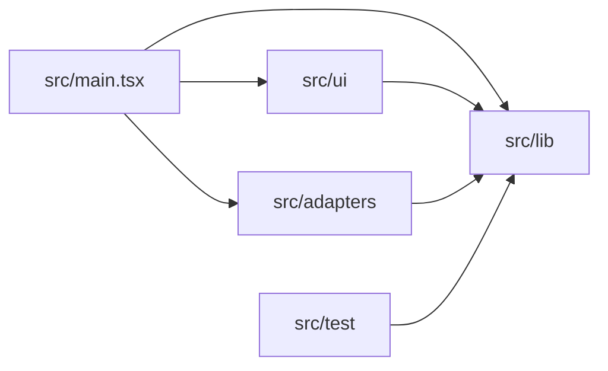
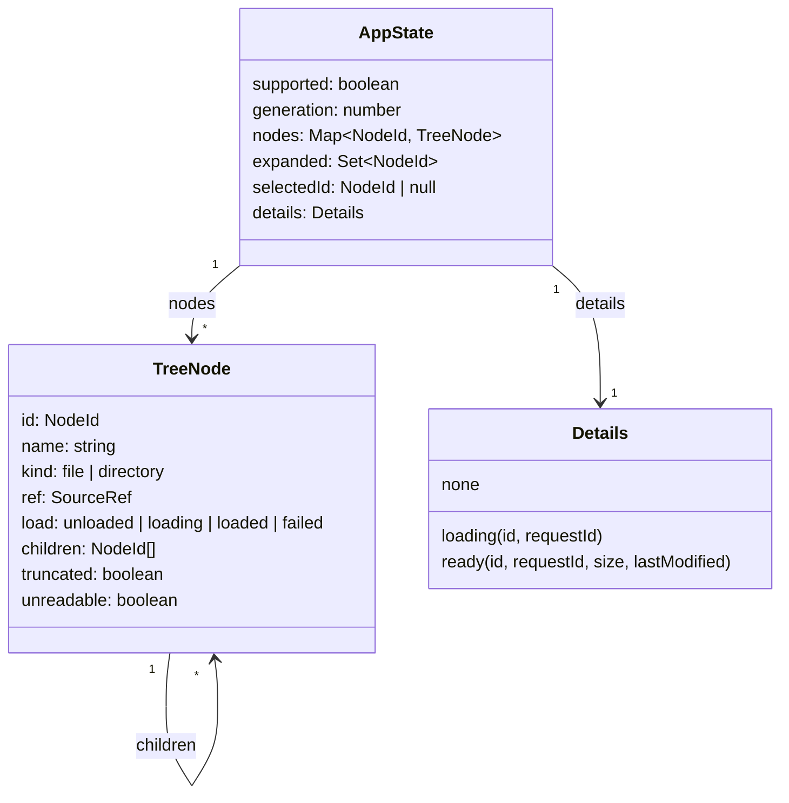
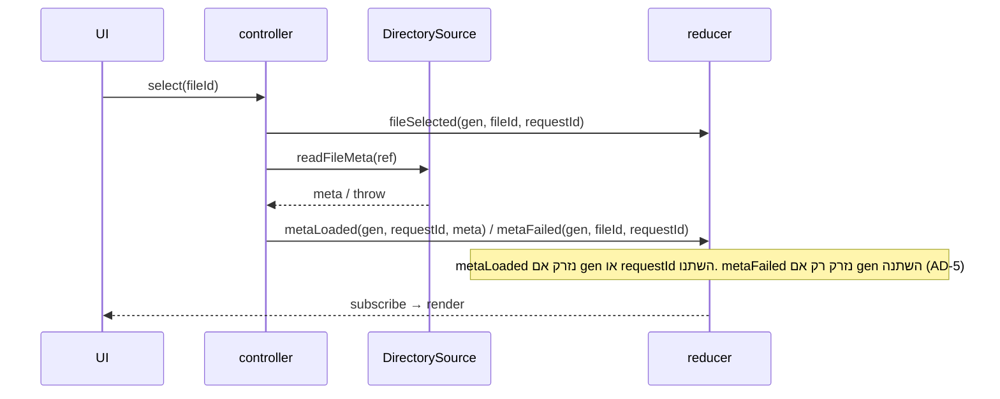

# Architecture Spine: file-browser-bmad

בכל החלטה יש שורת **למה** (משפט אחד) ושורת **שינוי מאוחר**:
🔴 קשה לשנות אחרי שנכתב קוד, כי כל השכבות נשענות עליה · 🟡 בינוני, שינוי שנוגע בכמה קבצים · 🟢 קל, שינוי מקומי.

## Design Paradigm

**Functional core / imperative shell**, בגרסה רזה של ports & adapters. ה-"core" של הדפוס יושב ב-`src/lib/`, לפי כללי הקורס:

| שכבה | תיקייה | מה יש בה | מותר לה לייבא |
|---|---|---|---|
| lib | `src/lib/` | TypeScript טהור: טיפוסים, reducer, controller, selectors, מיון, פורמטים, וה-port ‏`DirectorySource` | רק את `src/lib/` |
| adapters | `src/adapters/` | המימוש האמיתי של `DirectorySource` מעל File System Access API | `src/lib/` |
| ui | `src/ui/` | רכיבי React, ‏CSS וקובץ הטוקנים | `src/lib/` |
| composition root | `src/main.tsx` | מחבר adapter ל-controller ומרנדר את `App` | הכל |
| test doubles | `src/test/` | ‏`FakeDirectorySource` ועזרי בדיקה | `src/lib/` |



## Invariants & Rules

### AD-1: שלוש שכבות וכיוון תלות אחד

- **Binds:** all, ‏NFR-3
- **Prevents:** לוגיקה של עץ ובחירה שמתפזרת לתוך רכיבים, ו-React או FSA שנכנסים ללוגיקה.
- **Rule:** החצים בתרשים שלמעלה הם הרשימה המלאה של התלויות המותרות. ‏`src/lib/` לא מייבא את `react`, ‏`react-dom`, ‏`src/ui/` או `src/adapters/`, ולא נוגע ב-`window` או ב-`FileSystem*Handle`. ‏`src/ui/` לא מייבא את `src/adapters/`.
- **למה:** כך כל FR נבדק כפונקציה טהורה מול מקור מזויף, בלי דפדפן ובלי React.
- **שינוי מאוחר:** 🔴

### AD-2: ה-port ‏`DirectorySource` הוא הדרך היחידה לדיסק

- **Binds:** FR-1, FR-2, FR-3, FR-5, FR-7, ‏`src/adapters/`, ‏`src/test/`
- **Prevents:** שני רכיבים שקוראים ל-FSA כל אחד בדרך משלו, וטיפול שונה בשגיאות.
- **Rule:** החוזה מוגדר ב-`src/lib/source.ts`, ורק הוא:
  ```ts
  type EntryKind = 'file' | 'directory';
  interface Entry { name: string; kind: EntryKind; ref: SourceRef } // SourceRef: טיפוס אטום (branded)
  interface DirectorySource {
    isSupported(): boolean;                                   // FR-2
    pickRoot(): Promise<Entry | null>;                        // FR-1: ‏mode 'read'; כל כישלון → null
    listChildren(dir: SourceRef): AsyncIterable<Entry>;       // FR-3, FR-5: פריטים בסדר שבו הגיעו
    readFileMeta(file: SourceRef): Promise<{ size: number; lastModified: number | null }>; // FR-7
  }
  ```
  - רק ה-adapter פותח `SourceRef`. ה-handles נשמרים רק בזיכרון, בתוך ה-state הנוכחי, ונעלמים בהחלפת שורש.
  - ‏`isSupported()` = ‏`typeof window.showDirectoryPicker === 'function'`. זה מכסה גם דף שנפתח מחוץ ל-secure context (PRD §9).
  - ‏`pickRoot` קורא ל-`showDirectoryPicker({ mode: 'read' })` ואף פעם לא זורק. ה-DOM lib של TS 6.0 לא כולל את `showDirectoryPicker`, ולכן ההצהרה שלו נמצאת ב-`src/adapters/fsa.d.ts`, בלי חבילת `@types` חיצונית.
  - ‏`listChildren` הוא `async function*` ו-`readFileMeta` הוא `async`, בשני המימושים. כישלון מגיע רק כ-`next()` שנדחה או כ-promise שנדחה, ואף פעם לא כ-throw סינכרוני.
  - ב-V1 ה-adapter האמיתי תמיד מחזיר מספר ב-`lastModified`. ‏`null` קיים בשביל ה-fake ובשביל הטסט של `—`.
- **למה:** ממשק אחד וצר מאפשר ל-fake לשחזר בדיוק את שלושת מקרי הכישלון של FR-5 ואת הסדר ההפוך של FR-3.
- **שינוי מאוחר:** 🔴

### AD-3: Store אחד, שה-controller ב-lib הוא הבעלים שלו

- **Binds:** FR-1, FR-2, FR-3, FR-5, FR-6, FR-7, FR-8, ‏`src/lib/`, ‏`src/ui/`
- **Prevents:** בחירה שנשמרת ברכיב אחד ופרטים ברכיב אחר, ושני מקומות שמחליטים מתי לקרוא מהדיסק.
- **Rule:**
  - כל ה-state הוא אובייקט אחד (`AppState`, ראו התרשים ב-Structural Seed) שמשתנה רק דרך reducer טהור ב-`src/lib/reducer.ts`. ה-reducer immutable לחלוטין: כל שינוי מחזיר אובייקט חדש, ופעולה שנזרקת מחזירה את **אותו** reference.
  - ‏`createController(source)` ב-`src/lib/controller.ts` חושף רק `getState()`, ‏`subscribe()` ושלוש פקודות: `openFolder()`, ‏`toggle(id)`, ‏`select(id)`. ‏`getState()` מחזיר את `AppState` עצמו, לא תוצאה של selector.
  - **רק ה-controller מחליט על I/O.** הוא קורא את ה-state, מחליט אם צריך קריאה מהדיסק, שולח actions ל-reducer, ורק אחר כך קורא ל-source. ה-reducer אף פעם לא מסיק "צריך לקרוא" ולא משנה את `load` בתגובה ל-`toggled`.
  - ‏`supported` נקבע פעם אחת, ב-`createController`, מ-`source.isSupported()`. ‏`openFolder()` כש-`!supported` חוזר מיד, בלי לקרוא ל-`pickRoot`.
  - ה-UI קורא state רק דרך `useSyncExternalStore(subscribe, getState)`, ומחשב selectors מתוך התוצאה (עם `useMemo` לפי ה-state). הוא משנה state רק דרך שלוש הפקודות. אין `useState` או `useReducer` שמחזיקים state של עץ, בחירה או פרטים.
- **למה:** כל ההתנהגות של FR-1 עד FR-8 נבדקת על ה-controller לבד, והרכיבים נשארים תצוגה בלבד.
- **שינוי מאוחר:** 🔴

### AD-4: מזהה צומת = נתיב יחסי לשורש

- **Binds:** ‏`src/lib/`, ‏`src/ui/`
- **Prevents:** שתי שיטות מזהה, ו-React keys שמתנגשים.
- **Rule:** המזהה של השורש הוא `''`. ‏`childId(parent, name) = parent === '' ? name : parent + '/' + name`, ומוגדר רק ב-`src/lib/state.ts`. ‏`nodes` הוא `Map<NodeId, TreeNode>`, לא אובייקט רגיל (כדי ששם כמו `__proto__` לא ישבור אותו). ה-key של שורת מצב הוא `parentId + '\u0000' + 'status'`, ולכן הוא לא יכול להתנגש עם מזהה של פריט. אותם מזהים משמשים כ-React keys.
- **למה:** שם של פריט ייחודי בתוך התיקייה שלו ולא יכול להכיל `/`, ולכן הנתיב ייחודי ויציב בלי מונה.
- **שינוי מאוחר:** 🟡

### AD-5: תוצאה ישנה נזרקת ב-reducer

- **Binds:** FR-1, FR-3, FR-7
- **Prevents:** פרטים של קובץ A שמופיעים אחרי B, תוכן של שורש קודם שנכנס לעץ חדש, ו-`generation` שעולה פעמיים.
- **Rule:**
  - **החלפת שורש:** ה-controller מחשב `gen = state.generation + 1` ושולח action אטומי אחד, `rootPicked(gen, entry)`: ‏`generation = gen`, ‏`nodes` = רק השורש, עם `load: 'loading'`, ‏`expanded = {''}`, ‏`selectedId = null`, ‏`details = none`, ו-`supported` נשמר. אחר כך ה-controller קורא ל-`listChildren` של השורש ישירות, לא דרך `toggle`.
  - כל action שנשלח אחרי פעולה אסינכרונית נושא את ה-`gen` שבו היא התחילה, וה-reducer זורק אותו אם ה-`generation` השתנה.
  - **פרטי קובץ:** ‏`details` מחזיק `requestId` שעולה בכל `select` של קובץ. ‏`metaLoaded` נזרק אם ה-`generation` או ה-`requestId` השתנו. ‏`metaFailed` נזרק רק אם ה-`generation` השתנה: הוא תמיד מסמן את הקובץ `unreadable`, ומבטל את הבחירה רק אם ה-`requestId` עדיין תואם.
  - ‏`select` על הקובץ שכבר נבחר לא עושה כלום.
  - כל הבדיקות האלה נמצאות רק ב-reducer.
- **למה:** כשהבדיקה נמצאת במקום אחד, הטסט עם promises שנפתרים בסדר הפוך מכסה את כל המקרים, כולל A ← B ← A.
- **שינוי מאוחר:** 🟡

### AD-6: שגיאות הן נתונים, לא חריגות

- **Binds:** FR-3, FR-5, FR-6
- **Prevents:** ‏`try/catch` בכל רכיב, ושלושת מקרי FR-5 שמוצגים כל אחד אחרת.
- **Rule:** ה-controller תופס כל שגיאה של `DirectorySource` (ה-`try` עוטף גם את הקריאה ל-`listChildren` וגם את ה-`for await`), ושום שגיאה לא מגיעה ל-UI.
  - לכל תיקייה יש `load: 'unloaded' | 'loading' | 'loaded' | 'failed'` ו-`truncated: boolean`. ‏`TreeNode.unreadable` קיים רק לקבצים. תיקייה לא קריאה = `load === 'failed'`, ואין דגל נוסף.
  - ‏`listChildren` נכשל לפני הפריט הראשון ← `failed`. נכשל אחרי פריט אחד או יותר ← `loaded`, הפריטים שהתקבלו, ו-`truncated: true`.
  - **‏`toggle(id)`:** ה-controller שולח `toggled(id)`, שרק הופך את `expanded`. אם התיקייה נפתחה ו-`load === 'unloaded'`, הוא שולח `loadStarted(gen, id)` וקורא ל-`listChildren`. תיקייה נקראת פעם אחת בכל `generation`, גם אם הקריאה נכשלה. סגירה בזמן `loading` לא עוצרת את הקריאה.
  - התוכן של תיקייה נכנס ל-state בבת אחת, בסוף הקריאה (`loadSucceeded` / `loadTruncated` / `loadFailed`), בסדר שבו הגיע. ה-reducer ממיין אותו.
  - **‏`select(id)`:** על קובץ `unreadable` או על תיקייה `failed`, הבחירה מתאפסת ואין קריאה מהדיסק (ניסיון חוזר רק בבחירת שורש מחדש, FR-3). על תיקייה אחרת, היא נבחרת בלי קריאה מהדיסק (FR-8). על קובץ, הוא נבחר ו-`readFileMeta` נקרא מחדש בכל בחירה, בלי cache.
  - **תיקייה נבחרת שנכשלה בפתיחה:** ‏`loadFailed` לא משנה את `selectedId`. החלונית נשארת כמו שהיא (EXPERIENCE.md › State Patterns). "אי אפשר לבחור פריט לא קריא" (FR-5) חל על **לחיצה** על פריט שכבר ידוע שהוא לא קריא.
- **למה:** ה-addendum ביקש מצב מפורש לכל פריט, וזה מה שמאפשר טסט נפרד לכל אחד משלושת המקרים.
- **שינוי מאוחר:** 🟡

### AD-7: מיון ופורמטים הם פונקציות טהורות ב-lib

- **Binds:** FR-4, FR-7, ‏NFR-6
- **Prevents:** מיון שמתבצע פעם ב-reducer ופעם ברכיב, ופורמט של תאריך שתלוי במחשב שמריץ את הטסט.
- **Rule:**
  - ‏`compareEntries` ב-`src/lib/sort.ts`: תיקיות לפני קבצים. בתוך כל קבוצה `Intl.Collator('en', { numeric: true, sensitivity: 'base' })`, ובשוויון השוואה לפי code points. רק ה-reducer קורא לה, כשהתוכן נכנס ל-state.
  - ‏`src/lib/format.ts`: ‏`formatType(name)`, ‏`formatSize(bytes)` בחשבון שלמים (addendum), ‏`formatDate(ms, timeZone?)` עם `Intl.DateTimeFormat('en-US', { dateStyle: 'medium', timeStyle: 'short', timeZone })`. התו U+202F מוחלף ברווח רגיל, כך שהפלט הוא `Oct 22, 2026, 3:20 PM` בדיוק. ‏`null` או `NaN` ← `—`.
  - הרכיבים לא מפרמטים בעצמם. הם מקבלים מחרוזות מוכנות מה-selectors.
- **למה:** הטבלאות של FR-4 ו-FR-7 הופכות ישירות לטסטים של פונקציה אחת, בלי DOM.
- **שינוי מאוחר:** 🟢

### AD-8: ה-UI מרנדר מה שה-selectors מחשבים

- **Binds:** FR-1, FR-2, FR-3, FR-4, FR-5, FR-6, FR-7, FR-8, ‏`src/ui/`
- **Prevents:** רכיב שמחליט בעצמו מתי להציג `Loading…`, ‏`Empty folder`, חץ או הודעת כישלון.
- **Rule:** שלושה selectors ב-`src/lib/selectors.ts`, וה-UI לא קורא את `AppState` בשום דרך אחרת:
  - ‏`selectTopBar(state)` ← ‏`{ mode: 'unsupported', text }` או `{ mode: 'picker', rootName: string | null }`.
  - ‏`selectVisibleRows(state)` ← רשימה שטוחה, לפי DFS, של `{ type: 'item', id, name, icon: 'folder' | 'file', chevron: 'none' | 'collapsed' | 'expanded', depth, selected, unreadable }` או `{ type: 'status', key, depth, text }`. השורה הראשונה היא תמיד השורש, ב-`depth` 0, עם חץ, וניתנת לבחירה. לקובץ ולתיקייה `failed` יש `chevron: 'none'`.
  - **שורות מצב** מתחת לתיקייה פתוחה P מקבלות `depth(P) + 1`, ויש לכל היותר אחת: `Loading…` כש-`loading`; ‏`Empty folder` כש-`loaded`, אין ילדים ו-`!truncated`; ‏`Unable to read this item` כש-`truncated`, **אחרי כל תת-העץ** של P. מתחת לתיקייה `failed` אין שורות בכלל.
  - ‏`selectDetails(state)` ← ‏`{ type: 'empty' }`, ‏`{ type: 'loading', name }`, ‏`{ type: 'file', name, typeLabel, size, modified }` או `{ type: 'folder', name }`, עם מחרוזות מוכנות.
  - **שורת פריט:** אלמנט עם `data-depth`, ובתוכו `<button>` של החץ (רק כש-`chevron !== 'none'`, אחרת spacer באותו רוחב) ו-`<button>` של השם. כפתור השם כולל את האייקון, את השם ואת `unreadable-message`, ונמתח עד סוף השורה. ההזחה: `calc(attr(data-depth type(<number>), 0) * var(--spacing-indent))`, בלי `style`. בלי ARIA נוסף.
  - **אייקונים:** SVG inline עם `stroke="currentColor"` ו-class בלבד, בלי `width`, ‏`height` או `stroke-width` כ-attributes. הגודל ועובי הקו מגיעים מ-CSS ומהטוקנים.
- **למה:** כל טבלת State Patterns של EXPERIENCE.md הופכת לטסטים של selectors, והרכיבים נשארים טיפשים.
- **שינוי מאוחר:** 🟡

### AD-9: קובץ טוקנים אחד, ערכים בהירים בלבד

- **Binds:** NFR-4, ‏DESIGN.md
- **Prevents:** צבע או מרווח שנכתב ישירות ב-CSS של רכיב, או ב-`style={{…}}`.
- **Rule:** כל הערכים של DESIGN.md (צבעים, מרווחים, גופנים, רדיוסים) מוגדרים רק ב-`src/ui/tokens.css`, כ-custom properties על `:root`, עם `color-scheme: light`. שמות המשתנים לפי DESIGN.md: ‏`--color-accent`, ‏`--spacing-row-height` וכו'. ב-V1 נכתבים רק הערכים הבהירים, בלי `light-dark()`. שמות הטוקנים המורכבים: `--typography-body-font-size`, ‏`--typography-status-font-style`, ‏`--rounded-md` וכו'. בשאר קובצי ה-CSS מותר רק `var(--…)`. הקבצים `index.css` ו-`App.css` של התבנית נמחקים (יש בהם `color-scheme: light dark` וצבעים). ב-`app.css` יש reset אחד ל-`<button>` (בלי רקע, מסגרת ו-padding של הדפדפן).
- **למה:** ב-V1 אין מצב כהה, וערכי ה-dark כבר שמורים ב-DESIGN.md. המעבר ל-`light-dark()` בגרסה הבאה נוגע רק בקובץ הזה.
- **שינוי מאוחר:** 🟢

### AD-10: האכיפה היא חלק מפקודת הבדיקה

- **Binds:** NFR-3, NFR-4, NFR-5, ‏PRD §5
- **Prevents:** חוקים של AD-1, AD-9 ו-§5 שנשברים בשקט, כי הם כתובים רק במסמך.
- **Rule:**
  - ‏`npm run check` = ‏`tsc -b && oxlint --deny-warnings && stylelint "src/**/*.css" && vitest run`. זו פקודת הבדיקה היחידה.
  - **oxlint** (מורץ עם `--deny-warnings`, כי בלעדיו אזהרה לא מכשילה): ב-`src/lib/**`, ‏`no-restricted-imports` עם patterns שחוסמים את `react`, ‏`react/*`, ‏`react-dom`, ‏`react-dom/*`, ‏`**/ui`, ‏`**/ui/**`, ‏`**/adapters` ו-`**/adapters/**`, ו-`no-restricted-globals` שחוסם גם את `window`, ‏`globalThis`, ‏`self` ו-`document`. ב-`src/ui/**`, ‏`no-restricted-imports` על `**/adapters` ו-`**/adapters/**`. בכל `src/`: ‏`react/forbid-dom-props` חוסם את `style`, ו-`no-restricted-globals` חוסם את `localStorage`, ‏`sessionStorage`, ‏`indexedDB`, ‏`fetch`, ‏`XMLHttpRequest` ו-`WebSocket`. **פער ידוע ומקובל:** גישה דרך `window.localStorage` ב-ui או ב-adapters לא נתפסת, ונבדקת ב-code review.
  - **stylelint** (חוקי core בלבד, בלי plugins), על כל קובץ חוץ מ-`tokens.css`: ‏`color-no-hex`, ‏`color-named: never`, ‏`function-disallowed-list` לפונקציות צבע (`rgb`, ‏`hsl`, ‏`oklch` וכו'), ו-`unit-disallowed-list` ל-`px`, ‏`rem` ו-`em`. בכל הקבצים, כולל `tokens.css`: ‏`selector-pseudo-class-disallowed-list: [hover]`, ‏`property-disallowed-list` ל-`transition` ו-`animation`, ‏`declaration-property-value-disallowed-list` ל-`cursor: pointer`, ו-`media-feature-name-disallowed-list: [prefers-color-scheme]` (EXPERIENCE.md: בלי hover, בלי אנימציות, סמן רגיל, בהיר בלבד).
  - hook של pre-commit ב-`.githooks/pre-commit` מריץ את `npm run check`. ההפעלה אוטומטית, בסקריפט `"prepare": "git config core.hooksPath .githooks"` ב-`package.json`, בלי husky. החסימה של `fetch` וה-globals האחרים חלה גם על `src/test/`.
- **למה:** SM-2 דורש פקודה ירוקה בכל commit, וכל חוק שאפשר לבדוק במכונה עדיף על חוק שצריך לזכור.
- **שינוי מאוחר:** 🟢

### AD-11: טסטים מול `FakeDirectorySource`

- **Binds:** NFR-5, FR-1 עד FR-8
- **Prevents:** טסטים שכל אחד מהם בונה fake משלו, וטסטים שתלויים באזור הזמן של המחשב.
- **Rule:** תצורת Vitest נמצאת ב-`vite.config.ts`, עם `defineConfig` מ-`'vitest/config'` (ולא מ-`'vite'`, אחרת `tsc -b` נכשל) ו-`test: { environment: 'jsdom' }`. בלי `globals`: כל טסט מייבא מ-`'vitest'`. החבילות vitest, ‏jsdom ו-`@testing-library/*` נוספות כ-devDependencies, כי התבנית לא כוללת אותן. ‏`src/test/fakeSource.ts` מממש את `DirectorySource` מעץ שמוגדר כאובייקט. הוא מאפשר: (א) לעכב כל קריאה ולפתור אותה ידנית (deferred), כדי לבדוק סדר הפוך; (ב) כישלון לפי סוג: לפני הפריט הראשון, אחרי N פריטים, או ב-`readFileMeta`; (ג) ‏`isSupported: false`; (ד) טסט של `fsaSource` עצמו מחליף את `window.showDirectoryPicker` ב-stub ובודק שהוא נקרא עם `{ mode: 'read' }`, ושכל כישלון שלו מחזיר `null`. כל קובץ טסט מכסה FR אחד או יותר, ושם ה-`describe` מתחיל במזהה, למשל `describe('FR-5 …')`. טסטים של תאריך מעבירים `timeZone` במפורש. רוב הטסטים רצים על ה-controller וה-selectors. מעט טסטים של RTL מכסים את החיבור של הכפתורים.
- **למה:** כך הכיסוי של "כל FR בטסט אחד לפחות" (NFR-5) נבדק ב-grep פשוט.
- **שינוי מאוחר:** 🟡

## Consistency Conventions

| נושא | מוסכמה |
|---|---|
| שמות קבצים | ‏`camelCase.ts` ב-lib וב-adapters. ‏`PascalCase.tsx` לרכיבים. טסט לצד הקובץ: `x.test.ts` |
| שמות CSS | ‏class לכל רכיב לפי השם ב-DESIGN.md › Components: ‏`.tree-row`, ‏`.details-panel` וכו'. מצבים כ-modifier: ‏`.tree-row--selected`. CSS רגיל, בלי CSS modules ובלי ספריות |
| טקסטים בממשק | כל המחרוזות של EXPERIENCE.md › Voice and Tone מוגדרות פעם אחת, כקבועים ב-`src/lib/text.ts`, כולל `…` (U+2026). הטסטים מייבאים את אותם קבועים |
| שמות | בכל הקוד משתמשים במונחי המילון של PRD §3, באנגלית: `root`, ‏`item`, ‏`statusRow`, ‏`selected`, ‏`expanded`, ‏`unreadable` |
| bidi | כל אלמנט שמציג שם (עץ, חלונית, פס עליון) מקבל `dir="ltr"` ו-class שנותן `unicode-bidi: isolate`. זה מחליף במכוון את ההמלצה של ה-addendum ל-`dir="auto"`, שנבדקה ונדחתה ב-EXPERIENCE.md |
| תאריכים וגדלים | נשמרים כמספרים (`ms`, ‏`bytes`) ב-state. הופכים למחרוזות רק ב-selectors |
| ייבוא | נתיבים יחסיים, בלי aliases |

## Stack

| Name | Version |
|---|---|
| Node.js | ≥24.15 (נבדק על 24.22.1; המינימום של jsdom 30) |
| create-vite, תבנית `react-ts` | 9.3.1 |
| TypeScript | ~6.0.3 |
| React / React DOM | ^19.3.1 |
| Vite | ^8.3.4 |
| @vitejs/plugin-react | ^6.1.2 |
| oxlint | ^1.89.0 |
| stylelint | ^17.16.0 |
| Vitest | ^5.0.5 |
| jsdom | ^30.1.3 |
| @testing-library/react | ^16.3.3 |
| @testing-library/dom | ^10.4.2 |
| @testing-library/user-event | ^14.6.8 |
| Chrome (desktop) | 133 ומעלה (‏`attr()` עם טיפוס) |

הערות: TypeScript 7.0.2 כבר `latest` ב-npm, אבל נשארים על ~6.0.3 כי זו הגרסה ש-create-vite 9.3.1 קובע, והתבנית עוד לא עברה לקומפיילר החדש. התבנית של create-vite משתמשת ב-oxlint במקום ESLint, ושומרים על זה.

## Structural Seed

```text
src/
  main.tsx              # composition root: createController(createFsaSource()) → <App>
  lib/
    source.ts           # DirectorySource, Entry, SourceRef (AD-2)
    state.ts            # AppState, TreeNode, NodeId, Action
    reducer.ts          # reducer טהור (AD-3, AD-5, AD-6)
    controller.ts       # createController: פקודות, async, generation
    selectors.ts        # selectVisibleRows, selectDetails (AD-8)
    sort.ts             # compareEntries (AD-7)
    format.ts           # formatType, formatSize, formatDate (AD-7)
    text.ts             # מחרוזות הממשק
  adapters/
    fsaSource.ts        # File System Access API
    fsa.d.ts            # הצהרה של window.showDirectoryPicker
    fsaSource.test.ts   # mode 'read', כישלון → null
  ui/
    App.tsx  TopBar.tsx  Tree.tsx  TreeRow.tsx  DetailsPanel.tsx  icons.tsx
    useAppState.ts      # useSyncExternalStore
    tokens.css          # הקובץ היחיד עם ערכים (AD-9)
    app.css
  test/
    fakeSource.ts       # AD-11
.githooks/pre-commit    # npm run check
```



`load`, ‏`children` ו-`truncated` רלוונטיים רק לתיקייה, ו-`unreadable` רק לקובץ. ‏`Details` מתאר רק בחירה של קובץ. בחירה של תיקייה היא `selectedId` עם `details = none`. כשאין שורש, `nodes` ריק.



**סביבות והפעלה:** האפליקציה רצה רק מקומית, עם `npm run dev` על `localhost`, שהוא secure context (NFR-1). אין אירוח, אין CI ואין שרת. `npm run build` קיים, אבל לא נדרש ב-V1.

## Capability → Architecture Map

| FR / NFR | Lives in | Governed by |
|---|---|---|
| FR-1 בחירה והחלפה | ‏`controller.openFolder`, ‏`fsaSource.pickRoot`, ‏`selectTopBar`, ‏`TopBar` | AD-2, AD-3, AD-5, AD-8 |
| FR-2 דפדפן לא נתמך | ‏`fsaSource.isSupported`, ‏`AppState.supported`, ‏`selectTopBar` | AD-2, AD-3, AD-8 |
| FR-3 פתיחה, סגירה, בחירה | ‏`controller.toggle/select`, ‏`reducer`, ‏`TreeRow` | AD-3, AD-5, AD-6, AD-8 |
| FR-4 סדר ותוכן | ‏`sort.ts`, ‏`reducer` | AD-7 |
| FR-5 פריט לא קריא | ‏`controller`, ‏`reducer`, ‏`selectors` | AD-6, AD-8, AD-11 |
| FR-6 מצב ריק | ‏`selectDetails`, ‏`DetailsPanel` | AD-8 |
| FR-7 פרטי קובץ | ‏`format.ts`, ‏`selectDetails` | AD-5, AD-7 |
| FR-8 פרטי תיקייה | ‏`selectDetails` (בלי קריאה מהדיסק) | AD-8 |
| NFR-3 / NFR-4 / NFR-5 | ‏`.oxlintrc.json`, ‏`.stylelintrc.json`, ‏`npm run check` | AD-1, AD-9, AD-10 |

## Open Questions

- **הבדיקה הידנית של FR-5** (מ-PRD §9). צריך לבדוק ב-Chrome על macOS אם `getFile()` נכשל על קובץ עם `chmod 000`. **אחראית:** Ita, במהלך ה-story הראשון, אחרי שה-adapter עובד. **ברירת מחדל אם הקובץ לא נכשל:** הבדיקה הידנית תהיה על תיקייה עם `chmod 000`, שאמורה להיכשל ב-`values()`, או על קובץ שנמחק אחרי שהתיקייה שלו נקראה. לא חוסם: הטסטים האוטומטיים מכסים את שלושת המקרים דרך ה-fake.
- **הוחלט (אושר על ידי Ita):** תיקייה שנבחרה ואז נכשלה בפתיחה נשארת נבחרת (AD-6). כאן ה-UX (State Patterns) גובר על הניסוח של FR-5.

## Deferred

- **מצב כהה ו-`light-dark()`:** לגרסה הבאה. AD-9 מגביל את השינוי לקובץ `tokens.css`.
- **וירטואליזציה של רשימות ארוכות:** מחוץ להיקף (PRD §6). AD-8, הרשימה השטוחה, הוא הבסיס הנוח לה בעתיד.
- **ניווט במקלדת ו-ARIA:** מחוץ להיקף. החלוקה לשני `<button>` לא חוסמת אותם.
- **CI ואירוח:** אין צורך ב-V1. ה-hook המקומי מכסה את SM-2.
- **תצוגה מקדימה של תמונות ו-PDF:** בגרסה הבאה תתווסף ל-port מתודה כמו `readFile(ref)`. זה שינוי שמוסיף ולא שובר.
- **ביטול קריאות (`AbortController`):** לא נדרש, כי FR-3 קובע שהקריאה ממשיכה ברקע ו-AD-5 זורק את התוצאה.
